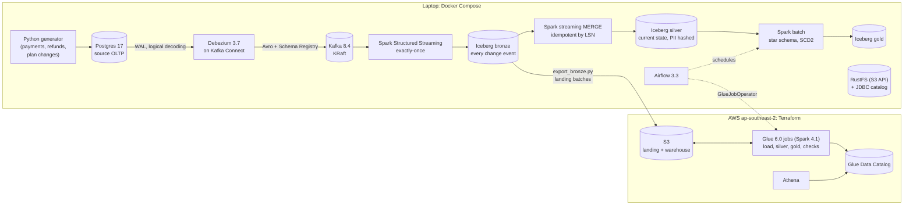

# Payments lakehouse: real-time CDC to an Iceberg star schema, locally and on AWS

[](https://github.com/arnavv-agarwal/payments-lakehouse/actions/workflows/ci.yml)

A data platform for a simulated Indian payment gateway. Every change in the
payments database is captured within a second (Debezium CDC into Kafka),
streamed by PySpark into Apache Iceberg tables (bronze, silver), and modelled
into a star schema with an SCD Type 2 merchant dimension (gold), so fees are
always computed with the rate in force at payment time. Airflow orchestrates
the batch layer and 40 data-quality checks. The same Spark jobs then run on
**AWS Glue** over S3, the Glue Data Catalog and Athena, provisioned with
Terraform, and produce results identical to the local run.

Correctness is measured rather than assumed: column-by-column reconciliation
against the source, crash and replay tests, an outage drill, deliberately
corrupted rows, and unit tests checked against injected bugs.

## Architecture



## Highlights

| Area | What was built | Evidence |
|---|---|---|
| **CDC** | Debezium on Postgres logical replication, Avro with Schema Registry | Connect killed with SIGKILL mid-stream: **0 rows lost**, 51 re-delivered (at-least-once), reconciliation PASS |
| **Streaming ingest** | PySpark Structured Streaming, Kafka to Iceberg, checkpointed | Driver killed + schema change mid-stream: **0 duplicates** across 664,930 rows |
| **Schema evolution** | A new source column (GSTIN) added during streaming | Job stops on an unknown schema id instead of mis-decoding, restarts, Iceberg table evolves |
| **Silver** | Newest event per key by WAL position (LSN), idempotent MERGE, soft deletes, HMAC-hashed PII | **737,259 rows match Postgres column by column**; full replay of all bronze: **+0 rows** |
| **Gold** | Kimball star schema, accumulating-snapshot fact, SCD Type 2 merchants, point-in-time joins, late-arriving dimensions | Fees credited 7x too high without SCD2 (₹11.0 lakh vs ₹1.57 lakh); incremental build equals a full rebuild |
| **Data quality** | 40 checks (25 on AWS): accuracy, completeness, freshness, keys, SCD2 rules, privacy | Outage drill: silver stopped 9 min, freshness check measured 526-541 s lag and failed the run |
| **Orchestration** | Airflow 3.3 (DockerOperator locally, GlueJobOperator on AWS) | A run with no new data skips all cloud tasks: $0 |
| **Cloud** | S3, Glue 6.0, Glue Data Catalog, Athena, IAM least privilege, SSM SecureString, Budgets, all in Terraform | AWS silver and gold **identical** to local (Spark vs Athena fingerprints, to the paisa) |
| **Testing and CI** | 23 unit tests (PySpark transformations, job plumbing), pyflakes, ShellCheck, Terraform validate, on GitHub Actions | Three injected bugs (fee rounding, validity boundary, LSN ordering) each caught by its test |

## Stack

Postgres 17 · Debezium 3.7 · Kafka 8.4 (KRaft) · Confluent Schema Registry ·
Apache Spark 4.1 (PySpark, Structured Streaming) · Apache Iceberg 1.12 / 1.11 ·
RustFS (S3 API) · Apache Airflow 3.3 · Docker Compose · AWS S3, Glue 6.0,
Glue Data Catalog, Athena, IAM, Systems Manager, Budgets · Terraform 1.17 ·
pytest · GitHub Actions

## Repository layout

| Path | Contents |
|---|---|
| `postgres/` | source schema (constraints, CDC publication), versioned migrations |
| `generator/` | realistic synthetic traffic: seed history, then live payments, refunds and plan changes |
| `connect/` | Debezium connector config and registration |
| `spark/jobs/` | `bronze_cdc`, `silver_cdc`, `gold_star`, `dq_checks`, `maintenance`, `export_bronze`, `load_bronze`, plus `lakehouse_env` (local vs Glue differences) |
| `airflow/dags/` | local DAGs (gold every 10 min, nightly maintenance) and AWS DAGs |
| `infra/` | Terraform: S3, Glue catalog and jobs, IAM, Athena, budget, logs |
| `tools/` | reconciliation, Glue/Athena helpers, key management, teardown |
| `tests/` | PySpark unit tests |
| `docs/` | one write-up per build step: design decisions, measurements, gotchas |

## Run it locally

Needs Docker (about 7 GB of memory for the full stack) and Python 3.12.

```bash
cp .env.example .env                      # fill in passwords and keys
docker compose up -d --wait               # Postgres, Kafka, Debezium, Spark, Airflow, ...
python -m venv .venv && .venv/bin/pip install -r requirements.txt
.venv/bin/python -m generator seed        # 30 days of history (~660K payments)
./connect/register.sh                     # start CDC
.venv/bin/python -m generator run         # live traffic (Ctrl+C to stop)
./spark/sql.sh -e "SELECT status, count(*) FROM silver.payments GROUP BY status"
```

Airflow: http://localhost:8088 · Kafka UI: http://localhost:8080 · Spark UIs: :4040 (bronze), :4041 (silver).

## Run the batch layer on AWS

```bash
aws login --region ap-southeast-2
cd infra && cp terraform.tfvars.example terraform.tfvars    # set alert_email
terraform init && terraform apply && cd ..
./tools/put_pii_key.sh                                       # hash key -> SSM SecureString
./tools/create_airflow_key.sh && docker compose up -d airflow
docker compose exec airflow airflow dags trigger lakehouse_aws
./tools/teardown_aws.sh                                      # delete everything afterwards
```

A full AWS run (ship a batch, then load, silver, gold and checks on Glue, then an
Athena report) takes about 10 minutes and a few US cents. All the Glue runs in
this project together used about 1.5 DPU-hours, well under one US dollar.

## Documentation

1. [Postgres source](docs/01-postgres-source.md) · 2. [Data generator](docs/02-data-generator.md) ·
3. [Kafka and Debezium CDC](docs/03-kafka-debezium.md) · 4. [Spark streaming into bronze](docs/04-spark-bronze.md) ·
5. [Silver](docs/05-silver.md) · 6. [Gold star schema and SCD2](docs/06-gold.md) ·
7. [Data quality and Airflow](docs/07-quality-and-orchestration.md) · 8. [AWS foundations](docs/08-aws-foundations.md) ·
9. [Landing batches to AWS](docs/09-landing-and-bronze-on-aws.md) · 10. [Batch layer on Glue](docs/10-batch-layer-on-glue.md) ·
11. [Airflow drives AWS](docs/11-airflow-drives-aws.md) · 12. [Tests, CI and teardown](docs/12-tests-ci-teardown.md)

## Limits

- The data is synthetic, shaped to behave like real payment traffic.
- Ingestion runs on one machine: a single Kafka broker, Airflow in standalone mode.
- On AWS only the batch layer runs; data arrives as batches exported from the local bronze.
- Airflow reaches AWS with a narrowly scoped IAM user key; inside AWS it would use an execution role instead.
